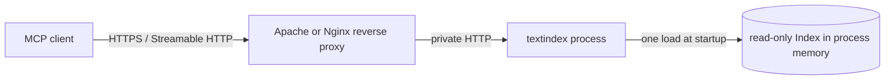

# MCP Streamable HTTP 設計メモ

## 状態と目的

この文書は将来の Streamable HTTP 対応に向けた設計案と未決事項を整理するものです。現時点で実装済みなのは stdio transport であり、ここに記載した HTTP サーバーやプロキシ設定はまだ提供していません。

目的は、MCP クライアントから HTTP 経由で検索できる常駐サービスを提供し、TLS 終端や認証などの境界機能は Apache / Nginx 等のリバースプロキシに委ねることです。MCP の transport とセッション管理には、採用済みの公式 Go SDK の Streamable HTTP handler を使う方針を推奨します。独自に JSON-RPC や SSE transport を実装しません。

## 推奨構成

- `textindex` は起動時に指定されたインデックスを一度だけ読み込み、プロセス終了まで保持します。
- HTTP サーバー、MCP Server、Streamable HTTP handler はプロセス起動時に一度だけ作成します。HTTP リクエストごとに `textindex` プロセスを起動したり、インデックスを再ロードしたりしません。
- すべての HTTP リクエスト / MCP セッションは同じプロセス内の `*Index` を参照します。Go の `net/http` が並行処理するリクエストから同じインデックスを共有し、インデックス全体をリクエストごとにコピーしません。
- サービスはループバックまたはプロキシ専用のプライベートネットワークに bind し、公開ネットワークから直接到達できないようにします。
- プロキシが TLS 終端、クライアント認証、必要なアクセス制御、レート制限を担当します。バックエンドは認証ヘッダーを無条件に信頼せず、プロキシ以外から到達できないネットワーク境界を前提とします。

現状の `web` コマンドも起動時にインデックスをロードして `net/http` に渡す構造です。HTTP 版を追加する場合はこのライフサイクルを参考にできますが、Web UI の `/api/*` は MCP transport ではないため、別 endpoint / handler として実装します。

## Index の共有と並行性

共有メモリの基本方針は「一つのプロセス内では一つの読み取り専用 Index」です。Go の HTTP handler は複数 goroutine から同時に呼ばれるため、プロセス内のメモリ共有は自然に行えます。OS thread ごとに Index を複製したり、リクエストごとにワーカープロセスを作ったりする設計にはしません。

ただし、公開 API には `Append` があり、FM-index の内部構造を変更します。検索と `Append` の並行実行を許可してはいけません。また、すべての occurrence 構造、特に外部ストレージ backend の読み取りが同時実行可能であることは、API の存在だけからは保証できません。HTTP 化の前に次を確認します。

- 対応対象とする index backend / occurrence 構造ごとに、同一 Index への並行検索を race detector 付きテストで確認する。
- 読み取り中は Index を不変に保つ。更新を将来追加する場合は、別の Index を完全にロードしてから参照先を切り替え、既存リクエストが旧 Index を使い終えるまで保持する。稼働中の Index に `Append` しない。
- 複数プロセスへ水平スケールする場合、プロセス間で Go heap を共有できないため、各プロセスが一つずつインデックスを保持する。レプリカ数に応じてメモリ使用量が増えることを容量計画に含める。

読み取り専用を前提にロックなしで検索できるかは backend ごとに検証して決定します。全検索を一つの大きな mutex で直列化する設計は、並行性を失うため避けます。必要な同期はセッション管理や Index の切り替えなど小さな共有状態に限定します。

## Reverse proxy の要件

Apache / Nginx は認証と TLS だけでなく、MCP transport の HTTP semantics を壊さずバックエンドへ中継する必要があります。配備前にプロキシ製品・バージョンごとの設定で以下を確認します。

- MCP endpoint の path と `GET` / `POST` / `DELETE` を中継する。HTTP メソッド、body、status、`Content-Type`、`Accept` を変換・破棄しない。
- `Mcp-Session-Id`、`Mcp-Protocol-Version`、`Last-Event-ID`、`Origin` など MCP の要求・応答ヘッダーを保持する。必要なヘッダーはクライアントへの応答にも返す。
- SSE を使う場合、レスポンス buffering を無効化してデータを逐次 flush する。proxy read / idle timeout は長時間接続に対応させ、圧縮や buffering がイベント配送を遅らせないことを確認する。
- クライアントが送った `X-Forwarded-*` や identity 系ヘッダーをそのまま信頼しない。プロキシで外部入力値を除去し、必要ならプロキシ自身が検証済みの値を設定する。
- バックエンドポートはプロキシからのみ到達可能にする。プロキシを迂回したアクセスでは認証を受けないため、loopback bind、firewall、private network のいずれかを必須にする。
- MCP Streamable HTTP が要求する Origin 検証を有効にする。プロキシの Host / Origin allowlist と SDK またはアプリケーションの検証責務を実装時に明確化する。

具体的な Apache / Nginx 設定例は、実装する endpoint、TLS 構成、SDK handler の挙動を確定してから別途追加します。設定例を追加する際は、認証を迂回できる直接 backend 接続がないことと SSE flush を統合テストします。

## セッションとスケール

Streamable HTTP のセッション方式は実装時に決定が必要です。SDK の通常 handler はプロセス内にセッション transport を保持するため、再起動でセッションは失われ、複数レプリカへ振り分けると後続リクエストが別レプリカに到着する可能性があります。

推奨する最初の段階:

- 単一プロセスで stateful session を提供し、MCP の POST と必要な GET / SSE、DELETE のライフサイクルを検証する。
- その後に複数レプリカが必要になった場合、ロードバランサーの session affinity、共有可能なセッション管理、または stateless モードのいずれを採用するか決める。affinity は可用性・再起動時のセッション喪失を解消しない。
- `search` と `index_info` のようにサーバー発の通知を必要としない tool-only 運用では、stateless / JSON response が適切かを別途評価する。SSE の GET やセッション維持が必要なクライアントには適用しない。

セッション ID は bearer credential と同等に扱い、ログに全文を記録しません。プロキシ認証の主体とセッションの対応、再起動後のクライアント再接続動作も検証対象です。

## 性能・運用上の配慮

- 同時リクエスト数を測定し、必要なら in-flight 上限を設定する。バックプレッシャー時の HTTP / MCP エラーと retry 方針を定義する。
- 検索結果の `limit`、context 長、request body サイズ、pattern 長、処理 deadline に上限を設ける。レスポンス量と regex 評価コストの双方を制御する。
- 既存の MCP `search` は `limit` と `context` を受け取ります。HTTP 版も同じ既定値と上限を共有し、stdio / HTTP で挙動が分岐しないようにします。
- 起動時に Index のロードに失敗した場合は readiness を成功させず、壊れた状態でリクエストを受けないようにする。readiness と liveness を分け、ロード完了後にのみ ready とする。
- SIGTERM 時は新規受付を止め、進行中の検索とセッションを期限付きで drain してから終了する。
- メトリクスには request 数、処理時間、in-flight 数、エラー、timeout、切り詰め件数、ロード時間、ロード後のメモリを含める。pattern、認証情報、セッション ID を不用意にログ出力しない。
- 性能試験では代表的な実データサイズ、Occ backend、検索 pattern、同時数を使い、p50 / p95 latency、throughput、CPU、heap、GC pause を測る。単一プロセスで Index を共有する構成と、複数 replica で Index を重複保持する構成を分けて評価する。

## 未決事項

1. 初期版のセッションを stateful にするか、tool-only stateless にするか。
2. 初期版でサポートする Index / Occ backend と external storage の範囲。
3. 更新時の Index 切り替えを初期版に含めるか。含めない場合、再ロードはプロセス再起動のみとするか。
4. HTTP endpoint、bind address、CLI flags、readiness / liveness endpoint の仕様。
5. 既定の同時実行数、request timeout、最大 pattern / body / response サイズ。
6. プロキシでの認証主体を認可に使う必要があるか。全クライアントが同一 Index を検索できる前提でよいか。
7. 水平スケール時に session affinity、stateless handler、共有 session store のどれを採用するか。

## 実装着手前の検証

- 公式 Go SDK の Streamable HTTP handler で MCP initialize、tools/list、tools/call、session close が動作する統合テストを追加する。
- 同じ Index に対する並行 `search` を全対象 backend で `go test -race` 実行する。`Append` との並行実行はサポートしないことをテストまたは API 境界で明確にする。
- 複数 MCP session と同時検索を含む負荷試験を行い、Index の複製が発生しないことを確認する。
- Apache / Nginx を介したテストで、認証失敗、Origin 検証、MCP headers、SSE flush、長時間接続、SIGTERM graceful shutdown を確認する。
- プロキシ以外から backend に接続できないことを deployment test で確認する。